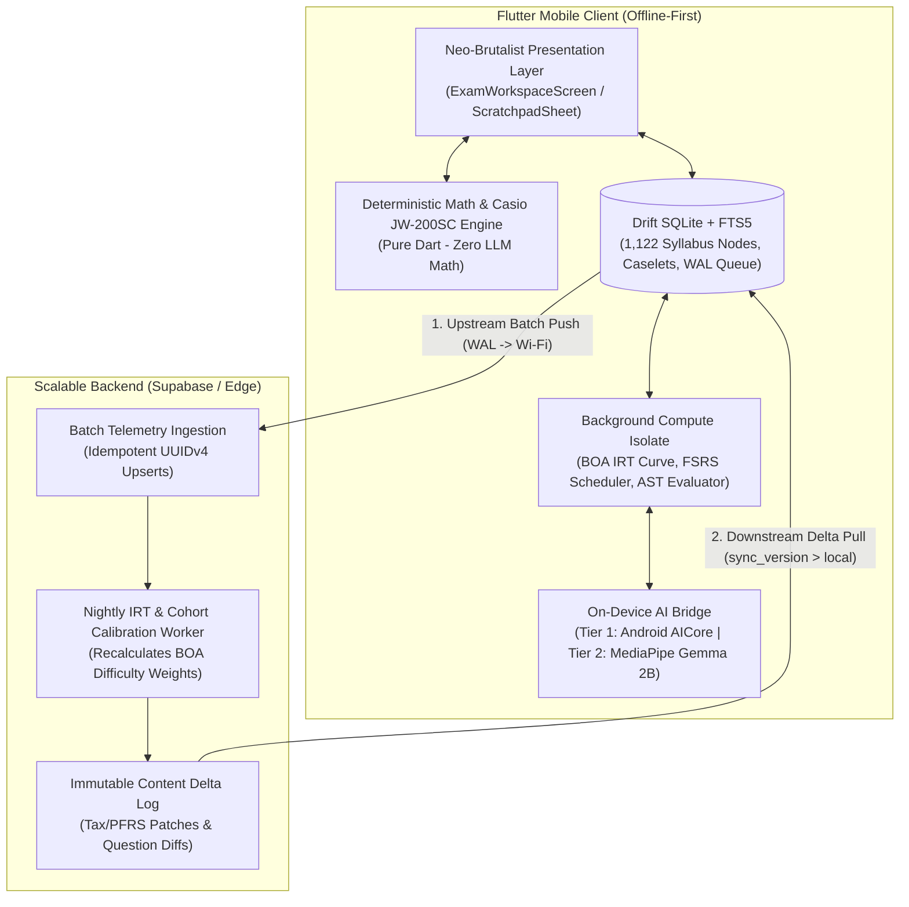
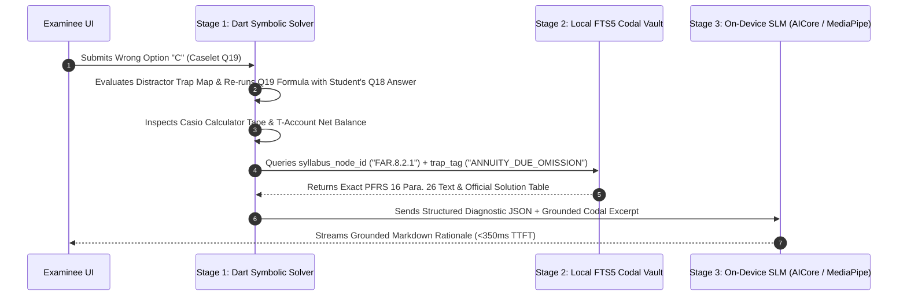

# PasaCPA Systems & Neuro-Symbolic AI Architecture Blueprint

This document defines the authoritative technical architecture, relational schemas, neuro-symbolic AI pipeline, and failure-mode safeguards for **PasaCPA**.

> [!IMPORTANT] Core Architectural Mandate
> 1. **100% Offline-First Exam Execution:** Switching questions, viewing multi-column general ledgers, computing on the Casio JW-200SC, and posting T-account entries must execute with **0ms network dependency**.
> 2. **Hard Neuro-Symbolic Boundary:** Small Language Models (SLMs) are strictly forbidden from performing standalone accounting arithmetic. All calculations, present value factors, tax brackets, and cascading caselet checks run deterministically in pure Dart (`lib/core/calculator/`). The on-device SLM is strictly constrained to narrating pre-verified diagnostic facts and grounded statutory text.

---

## 1. End-to-End System Topology



---

## 2. Core Data Structures & Local Relational Schema (Drift SQLite)

To track student progress across **6 subjects, 450 board questions, and 1,122 syllabus nodes** (from [[00 - Master CPALE Syllabus & Table of Specifications]]), the local SQLite database is structured around four primary tables:

### A. Hierarchical Syllabus DAG (`syllabus_nodes`)
Encodes the official PRC BOA Resolution No. 2022-30 hierarchy:
- `node_id` (`TEXT PRIMARY KEY`): Canonical dotted path (e.g., `"FAR.8.2.1"`, `"RFBT.7.2.17.1.2.1"`, `"TAX.5.1.6"`).
- `subject_code` (`TEXT`): `"FAR"`, `"AFAR"`, `"MS"`, `"AUD"`, `"RFBT"`, `"TAX"`.
- `parent_id` (`TEXT NULLABLE`): Adjacency pointer enabling instant upward rollup from leaf nodes to major sections (`1.0`–`14.0`) and subjects.
- `title` (`TEXT`): Official BOA syllabus description.
- `cognitive_tier_default` (`INTEGER`): `1` (Remembering/Theory), `2` (Applying/Computation), `3` (Evaluating/Monster Caselet).
- `statutory_anchor_ids` (`TEXT` JSON array): Links to local codal sections (e.g., `["RA_11976_SEC_113", "PAS_12_PARA_15"]`).

### B. Grouped Caselets & Cascading Dependency Graph (`exam_caselets` & `exam_questions`)
Models standalone MCQs and multi-item accounting caselets:
- `caselet_id` (`TEXT PRIMARY KEY`): Shared narrative stem and structured ledger JSON (`AccountingLedgerTable`).
- `question_id` (`TEXT PRIMARY KEY`): Individual MCQ item.
- `syllabus_node_id` (`TEXT REFERENCES syllabus_nodes(node_id)`).
- `depends_on_question_id` (`TEXT NULLABLE`): Self-reference for sequential caselet items (e.g., Item 19 *Year 2 Carrying Amount* depends on Item 18 *Initial Lease Liability*).
- `parametric_formula_ast` (`TEXT` JSON): Deterministic formula representation allowing the Dart solver to recompute downstream answers using a student's upstream choice.
- `distractor_trap_map` (`TEXT` JSON): Maps each wrong option (`A`–`D`) to its specific error classification and explanation metadata:
  ```json
  {
    "B": {
      "trap_code": "RCIT_25_INSTEAD_OF_MSME_20",
      "summary": "Applied 25% regular corporate rate instead of 20% CREATE MSME rate (Net Income <= 5M and Assets <= 100M excl. land)."
    },
    "C": {
      "trap_code": "INCLUDED_LAND_IN_100M_ASSET_TEST",
      "summary": "Included land value (₱25M) in the ₱100M total asset threshold test under RA 11534."
    }
  }
  ```

### C. Append-Only Telemetry & Sync WAL (`attempt_events`)
Every examinee interaction writes an immutable event record locally in `<2ms`:
- `tx_id` (`TEXT PRIMARY KEY`): Client-generated `UUIDv4` for idempotent cloud sync.
- `session_id` (`TEXT`), `question_id` (`TEXT`), `syllabus_node_id` (`TEXT`).
- `selected_option` (`TEXT`), `is_correct` (`INTEGER`).
- `dwell_time_ms` (`INTEGER`): Time spent viewing the item.
- `eliminated_options_mask` (`INTEGER`): Bitmask of options struck through via long-press (`McqOptionCard`).
- `calculator_tape_json` (`TEXT`): Last operations & $K$-constant state from `CasioCalculatorEngine`.
- `t_account_snapshot_json` (`TEXT`): Debit/credit entries posted in `ScratchpadSheet`.
- `sync_status` (`INTEGER`): `0` = Pending local WAL, `1` = Synced to Supabase.

### D. Materialized Mastery & BOA Readiness State (`topic_mastery_state`)
Maintained by a background Dart Isolate so the UI thread never drops frames:
- `syllabus_node_id` (`TEXT PRIMARY KEY`).
- `fsrs_stability` (`REAL`), `fsrs_difficulty` (`REAL`), `last_reviewed_at` (`INTEGER`), `retrievability` ($R = e^{-t/S}$).
- `rolling_accuracy` (`REAL`), `irt_scaled_rating` (`REAL`).
- `avg_l1_dwell_ms` (`INTEGER`), `avg_l2_dwell_ms` (`INTEGER`), `time_trap_count` (`INTEGER` — items with `dwell_time_ms > 210000` and `is_correct == 0`).
- `is_below_condition_floor` (`INTEGER` boolean — triggers the **⚠️ CONDITIONED WARNING** if any subject's scaled rating is `< 60.0%` even when General Weighted Average is `>= 75.0%`).

---

## 3. Scalable Backend Layout (Delta-Sync & Batch Calibration)

### A. Downstream Content Distribution: Immutable Delta Log
Instead of querying a remote database during exams, the cloud backend functions as a versioned patch server ([[07 - Delta-Based Background Sync Engine]]):
1. Clients store `local_sync_version` (e.g., `1042`).
2. When Congress enacts tax changes (e.g., RA 11976 EOPT Act invoicing rules) or BOA issues syllabus updates, admins publish a row to `content_delta_log` (`version_id`, `entity_type`, `entity_id`, `operation`, `payload_diff`).
3. Clients fetch `GET /rest/v1/content_delta_log?version_id=gt.1042` via CDN-cached endpoints and apply the diff inside a local SQLite transaction.

### B. Upstream Telemetry & Nightly IRT Recalibration
1. When unmetered Wi-Fi is available, a background worker (`workmanager`) pushes pending `attempt_events` (`sync_status = 0`) in batches of 250 via an idempotent PostgreSQL RPC (`upsert_attempt_events_batch`).
2. A nightly Supabase cron job computes cohort-wide 3-Parameter Logistic (3PL) Item Response Theory parameters (difficulty $b$, discrimination $a$, guessing $c$) and emits updated curve weights into the next day's delta log.

---

## 4. Highest-Impact Local AI Feature: Neuro-Symbolic "Distractor Trap & Cascading Error Rationalizer"

Ref: [[02 - AI-Powered Rationalizer & ELI5]]

### A. Concrete Student Value
1. **Distractor Trap Diagnosis:** Identifies the exact rule omission or arithmetic slip that produced the student's chosen wrong option (`B`, `C`, or `D`).
2. **Cascading Premise Auditing (Grouped Caselets):** Re-evaluates downstream caselet questions in pure Dart by substituting the student's wrong upstream answer. If the downstream method holds, it validates the student's downstream procedure and isolates the root-cause error to the upstream item.
3. **Grounded Statutory Proof + ELI5 Toggle:** Links the step-by-step accounting table directly to the governing PFRS/PAS/NIRC provision, with a toggle between **Board Proof** and **ELI5 Mental Model**.

### B. 3-Stage Neuro-Symbolic Execution Pipeline



- **Stage 1 (Pure Dart Symbolic Solver):** Computes all figures, checks cascading carry-forwards, and inspects the T-account scratchpad and calculator tape to output a verified `DiagnosticFactSheet` JSON.
- **Stage 2 (Local FTS5 Codal Lookup):** Pulls the exact statutory paragraph from `codal_vault` ([[09 - Offline Codal & Tax Matrix Quick-Vault]]) by `syllabus_node_id` and `statutory_anchor_ids`.
- **Stage 3 (Tiered On-Device SLM):**
  - **Tier 1 (Android AICore):** System-level **Gemini Nano** on NPU (0MB app size overhead).
  - **Tier 2 (MediaPipe LLM Inference):** On-demand 4-bit quantized **Gemma-2-2B-IT** (`.task` bundle) for mid-range devices without AICore.
  - **Tier 3 (Low-RAM `< 4GB` Deterministic Fallback):** Bypasses neural generation and renders the `DiagnosticFactSheet` + static author rationale via a deterministic Markdown template.

---

## 5. Trade-Offs, Failure Modes & Safeguards

| Failure Mode / Bottleneck | Root Cause | Concrete Architectural Safeguard |
| :--- | :--- | :--- |
| **1. Arithmetic & Sign-Flip Hallucinations** | 2B-parameter SLMs fail multi-step accounting arithmetic and debit/credit signs. | **Hard Neuro-Symbolic Split:** The SLM never calculates. It only narrates numbers pre-computed in `DiagnosticFactSheet`. A post-generation regex filter verifies every `₱` figure emitted by the SLM exists in the input JSON; any mismatch falls back to the deterministic table. |
| **2. Statutory Obsolescence (Pre-training Cutoff)** | Base model weights recall outdated pre-CREATE or pre-EOPT rules (e.g., citing Official Receipts for services instead of Sales Invoices under RA 11976). | **Strict Codal Prompt Injection:** Injects the delta-synced `codal_vault` text block with a system override directive instructing the model to treat the injected statute as sole legal truth over prior weights. |
| **3. Mid-Exam OOM Crash on 4GB RAM Phones** | Loading a 1.3GB quantized SLM alongside Flutter UI during a 3-hour 70-item exam triggers Android's Low Memory Killer. | **Exam-Mode AI Lockout & Synchronous WAL:** AI models are strictly unloaded during active timed exams; every tap and T-account entry writes synchronously to SQLite in `<2ms` for instant crash recovery. |
| **4. Thermal Throttling & Battery Drain** | Repeated on-device inference warms mobile SoCs. | **On-Demand Trigger + SQLite Memoization:** Inference runs only on explicit tap of `"⚡ Ask On-Device AI"` and caches output by `(question_id, selected_option, cascading_hash, sync_version)`. |

